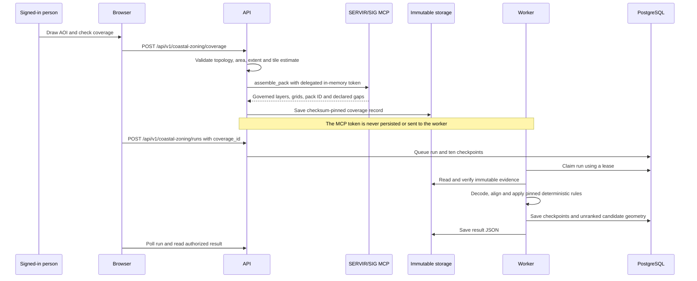

# SERVIR Global Risk Platform

This repository is the implementation foundation for the ADPC Hub of the SERVIR Global Risk Platform (GRP) MVP 1. It follows solution architecture `GRP-ARC-001` version 2.2: ADPC owns access, data, GIS processing, and immutable assessment results; SIG reads only Admin-approved results to build traceable evidence and receipts.

> **Current status:** The local Docker Desktop build includes access and Admin controls, the metered AI gateway, Planner chat/map, receipt-bound SIG hazard/risk embeds, and the managed Thailand baseline. Under ADR-0015's explicit Product Owner approval assumption, Platform Admins can record the versioned SIG risk recipe and activate the imported boundaries, evacuation centres and RP100 hazard. ADR-0016 makes Planning display those available layers immediately; a queued assessment is optional rather than a prerequisite for seeing data. Local assessment proofs succeeded for Mueang Nan and Bang Bua Thong. Staging has not been deployed; see [`handovers.md`](handovers.md) for the exact revision, validation record and remaining production gates.

For the current implementation inventory, known limitations, validation record, and exact next slice, read [`handovers.md`](handovers.md).

## Architecture

```mermaid
flowchart LR
    Browser -->|HTTPS| Caddy
    SIG[SIG Risk pack] -->|shared evidence only| Caddy
    Caddy --> API[grp-api / FastAPI]
    API --> DB[(PostgreSQL + PostGIS)]
    Worker[grp-worker] --> DB
    Worker --> Files[/srv/grp/data]
    API --> Files
```

The API validates identity, Hub membership, permissions, and inputs. The worker is the only component allowed to calculate GIS results. Successful results are immutable and are reused by the screens, exports, SIG integration, and later AI explanations.

## Repository layout

```text
api/              FastAPI entry point and bounded API modules
worker/           Background job and GIS-worker boundary
core/             Shared models, validation, result rules, and storage protocol
migrations/       Alembic environment and versioned database migrations
grpcli/           Server-side access administration commands
web/              Existing-SIG registration, sign-in, and protected workspace screens
deploy/           Ubuntu Compose, Caddy, and deployment guidance
tests/            Fast, contract, golden, live, and load test layers
docs/adr/         Architecture decision records
```

## Local quick start

Python 3.12 is required.

```powershell
python -m venv .venv
.\.venv\Scripts\Activate.ps1
python -m pip install -e ".[dev,gis]"
python -m pytest
.\scripts\run-local.ps1 -RegisterSigClient
```

The first run creates ignored SQLite/session files and registers the exact localhost callback. Later runs use `.\scripts\run-local.ps1`. Open `http://127.0.0.1:8000/register.html`, choose **Continue with SIG**, and authenticate in SIG. A verified account without GRP membership returns to the pending screen.

Bootstrap a different existing SIG user as Platform Admin, then create the ADPC Hub:

```powershell
.\scripts\admin-local.ps1 bootstrap-platform-admin --email admin@example.org
.\scripts\admin-local.ps1 ensure-hub --actor-email admin@example.org --code adpc --name "ADPC Hub"
```

Replace the sample with the administrator's verified SIG email. The admin then opens `http://127.0.0.1:8000/admin`, authenticates through SIG, and reaches the protected approval panel. Platform Admins and Hub Admins add people by work email and can change and disable members of Hubs they manage, and the last active Hub Admin is protected. State-changing requests need the `X-CSRF-Token` header (value from the `grp_csrf` cookie). Sign-out and any role or access change end that person's sessions on the server. Authentication proves the SIG identity; only an active GRP membership grants application access. The interim sign-in flow is recorded in `docs/adr/0002-interim-sig-mcp-client-login.md`; its access token is not kept.

## LLM token preparation

AI is enabled only in the local Docker Desktop configuration and still defaults off for server deployments. Both environment templates contain provider, model, base URL, output limit, and `AI_KEY_FILE_ADPC`. Store a local token through hidden input:

```powershell
python -m grpcli.configure set-ai-key
```

This writes `.local/secrets/ai_key_adpc`, which Git ignores. On staging, place the token at `/srv/grp/secrets/ai_key_adpc` with root ownership and mode `0600`. Never put the raw token in `.env`; `.env` contains only the file path. Do not enable AI outside the approved local configuration until its deployment and budget controls are accepted.

## Run in Docker Desktop

The local stack runs PostGIS, Alembic migrations, the API (with the web screens) and the worker shell:

```powershell
.\scripts\docker-desktop.ps1 -AdminEmail you@adpc.net
```

Open `http://127.0.0.1:8000` (sign-in) or `http://127.0.0.1:8000/admin`. The script creates ignored secrets under `.local/docker/secrets`, reuses the localhost SIG client from `.\scripts\run-local.ps1 -RegisterSigClient`, runs migrations, and makes each `-AdminEmail` a Platform Admin with the `adpc` Hub. Stop it with `.\scripts\docker-desktop.ps1 -Down`; data stays in Docker volumes. This file is for local demos only; servers use `deploy/compose.yml`.

## Mangrove 360 coastal zoning branch guide

This branch, `adhoc/grp-coastal-zoning-integration-spec-2026-10-23`, adds the first working
Mangrove 360 coastal-zoning workflow. It is intended for a colleague to run, inspect, and extend
without treating an attractive map as stronger evidence than it is.

### What a user can do

1. Sign in with the existing SERVIR/Global Risk identity.
2. Open `http://127.0.0.1:8000/coastal-zoning.html`.
3. Choose the Lamu, Kenya or South Sumatra, Indonesia evidence profile.
4. Click at least three map points, finish the polygon, and check live evidence coverage.
5. Review the governed layers and declared gaps, then run the assessment.
6. Watch persistent P1–P10 progress and reopen completed work from the recent-runs list.
7. Inspect four map views:
   - **All zoning classes** shows the complete zoning grid and color key.
   - **All opportunities** dims the base grid and highlights every candidate polygon.
   - **Resort candidates** zooms to coastal and inland screening locations.
   - **Restoration candidates** zooms to restoration and planting/reconnection locations.
8. Click a short candidate ID such as `C1`, `R1`, or `P1` for its area and status, or download the
   result JSON.

A tab changes both the explanation and the map. Matching polygons receive bright category colors,
non-selected cells dim, and the map zooms to the matching locations. A view with no candidates
says so explicitly instead of showing an unchanged map.

### How it works



The API performs only bounded coordination and validation. GIS calculations stay in
`worker/`. `core/coastal_zoning/pipeline.py` has no MCP client and receives no user credential.
Coverage records are bound to the signed-in user, Hub, AOI hash, profile, and expiry. Unknown,
cross-Hub, incomplete, expired, or altered inputs fail closed.

The current profiles require all of these governed inputs:

- **Lamu:** 1996/2020 mangroves, Copernicus DEM, wetlands, WorldCover and WorldPop.
- **South Sumatra:** 2017/2024 mangroves, landforms, DEM, WorldPop, flood and fire layers.

Missing evidence remains unknown; it is never converted to zero or low risk. The deterministic
rules are pinned to source SHA-256
`a3ec7fbc65190a9b76e4ef1c8a6231f4a9de26108603d6e7ffbdaf770059700d` and checked against the
approved local South Sumatra and Lamu goldens when those restricted fixtures are available.

### Trust labels and current limits

This branch produces a **map-grid estimate**, not a permit, legal determination, engineering
survey, financial estimate, or carbon-credit estimate. A candidate is a place to investigate, not
a place the user may build. Zone-level `publish_answer` receipts are not minted yet, so candidates
remain unranked and P7–P9 are visibly skipped. Full-resolution raster processing and the five
shapefile/ZIP packages remain follow-up work. Do not remove these labels merely to make a demo
look complete.

The supplied starter-kit fixture bytes and DEM remain uncommitted until their licence and vintage
are approved. The deployed Mangrove 360 brand assets are committed and pinned to their supplied
manifest hashes; decorative illustrations are labelled as non-geographic evidence.

### Important implementation files

```text
api/coastal_zoning.py                 Protected coverage, run, result, review and retire routes
core/coastal_zoning/aoi.py            GeoJSON topology, area, extent, scale and tile validation
core/coastal_zoning/jobs.py           P1-P10 state machine, claims, retries and cancellation
core/coastal_zoning/pipeline.py       Credential-free deterministic worker execution
core/coastal_zoning/rules.py          Pinned Mangrove 360 zoning rules
core/coastal_zoning/models.py         Runs, steps, zones, artifacts and review logs
worker/main.py                         Coastal run claim loop
web/coastal-zoning.*                  Map drawing, progress and four-view report UX
migrations/versions/20261023_0029_*   PostgreSQL schema
```

Architecture rationale and the implementation plan are in
[`ADR-0070`](docs/adr/0070-coastal-zoning-is-a-checkpointed-worker-pipeline.md) and
[`docs/adhoc/grp-coastal-zoning-implementation-plan-2026-10-23.md`](docs/adhoc/grp-coastal-zoning-implementation-plan-2026-10-23.md).

### Run focused checks

```powershell
python -m pytest `
  tests/fast/test_coastal_zoning_aoi.py `
  tests/fast/test_coastal_zoning_api.py `
  tests/fast/test_coastal_zoning_jobs.py `
  tests/fast/test_coastal_zoning_mcp.py `
  tests/fast/test_coastal_zoning_pipeline.py `
  tests/fast/test_coastal_zoning_rules.py `
  tests/contract/test_coastal_zoning_sig_contract.py `
  tests/golden/test_coastal_zoning_rules.py
python -m ruff check api/coastal_zoning.py core/coastal_zoning worker/main.py
node --check web/coastal-zoning.js
```

The golden tests skip when the restricted local fixture paths are unavailable. Run the complete
offline suite with `python -m pytest -q` before merging.

### Let a remote colleague test temporarily

Use a temporary HTTPS tunnel, not a raw public database/API port. SERVIR OAuth requires the exact
public callback URL, so a random tunnel address needs a separately registered public PKCE client
and temporary `GRP_PUBLIC_BASE_URL`, `SERVIR_AUTH_CLIENT_ID`, and
`SERVIR_AUTH_REDIRECT_URI` values. For example, the origin can remain local HTTP:

```powershell
cloudflared tunnel --url http://127.0.0.1:8000 --no-autoupdate
python -m grpcli.oauth register-client `
  --redirect-uri https://YOUR-TUNNEL.trycloudflare.com/api/v1/auth/callback `
  --client-name "ADPC GRP temporary coastal test" `
  --output-file .local/tunnel/servir_client_id
```

Do not commit the generated client file, tunnel override, cookies, tokens, or `.env`. The tester
still needs an approved SERVIR identity and active GRP Hub membership. Stop the tunnel after the
agreed window and restore the normal localhost OAuth settings. A quick tunnel has no uptime
commitment and is for short testing only.

### Test the shelter upload and district workflow

In the local development build, a Platform Admin can open **Data library**, upload one ZIP with
the `ddpm_shelters` Shapefile components, and follow the background validation progress. Review
the quality counts, then choose **Use in new assessments** for the exact immutable version.

Open **Planning**, select a supported district, and choose **Data & run**. Confirm the flood
scenario, accepted shelter source, and method, then start the assessment. The drawer shows six
persisted worker steps; the finished map and **Centres** tab use the same feature IDs and list every
returned shelter name, status, reason, and mapped flood depth. The recommendation identifies only
lower-exposure candidates and explicitly leaves capacity, access, services, routes, and other
hazards for human review. Optional SIG context is separate and never blocks the local result.

The browser upload/accept action is a developer-only Platform baseline path. Production Hub-local
ownership and Hub Admin approval remain a later hardening step; uploaded data is never sent to SIG
automatically.

The current components, trust boundaries, worker sequence and production extension are diagrammed
in [`docs/shelter-upload-assessment-architecture.md`](docs/shelter-upload-assessment-architecture.md).

### Install the Thailand Hub baseline

Keep the approved source bundle outside Git under `.local/data-in`. After the Docker stack and an
ADPC Platform Admin exist, install the currently supported district boundaries, DDPM shelters and
RP100 source in dependency order:

```powershell
.\scripts\docker-desktop.ps1 -AdminEmail you@adpc.net -BootstrapThailandData
```

On Ubuntu, use:

```bash
./scripts/docker-ubuntu.sh --admin-email you@adpc.net --bootstrap-thailand-data
```

The command hashes the source bytes, queues the GIS work, waits for the
worker and activates the exact imported versions. It is safe to rerun. See **Data library** for the
active release and [`deploy/UBUNTU_SHARED_HOST.md`](deploy/UBUNTU_SHARED_HOST.md) for paths and
operations.

## Run on a shared Ubuntu host

When another application already owns ports 80/443, run the local demo stack on the Ubuntu loopback address and reach it through an SSH tunnel:

```bash
./scripts/docker-ubuntu.sh --register-sig-client --configure-ai --configure-langfuse \
  --admin-email you@adpc.net --hub-admin-email you@adpc.net
```

This binds only to `127.0.0.1:8000` and does not install or change Caddy. Keep port 8000 closed in the AWS security group; configure a PuTTY local tunnel from port 8000 to `127.0.0.1:8000`, then browse to `http://127.0.0.1:8000`. See [`deploy/UBUNTU_SHARED_HOST.md`](deploy/UBUNTU_SHARED_HOST.md) for prerequisites, reruns, status, shutdown, OAuth, and secret handling.

## Sign-in and membership mapping

GRP registration is only for people who already have a SIG/SERVIR account. It collects no local password or unverified identity data: the applicant must complete SERVIR authentication before a pending request appears. An unknown verified identity creates an `identity_link_denied` audit event for administrator review, but no user, external identity, or membership record. After an administrator assigns a Hub role, the user returns to sign in and GRP links the external identity.

Architecture roles are `ndmo_planner`, `hub_expert` (Hub Expert / GIS Specialist), Hub `admin`, and Platform Admin. The two planning roles have the same least-privilege planning access in this release; only Hub Admin manages Hub membership. See [`docs/access-management.md`](docs/access-management.md) for the table map and provisioning commands.

## Staging deployment

The target is Ubuntu 24.04 at `staging-risk-servir.adpc.net`. Caddy runs on the host; the API is published only to `127.0.0.1:8000`; PostGIS has no host port.

The idempotent bootstrap installs the host dependencies, creates the filesystem layout and secrets, deploys the stack, and verifies health. It can either build from source on the VM or pull the prebuilt GHCR image:

```bash
sudo /srv/grp/bootstrap/bootstrap-ubuntu.sh --deploy-mode source
sudo /srv/grp/bootstrap/bootstrap-ubuntu.sh --deploy-mode image
```

Follow [`deploy/BOOTSTRAP.md`](deploy/BOOTSTRAP.md) for the first-run download commands, firewall safeguards, GHCR authentication, verification, and recovery steps. Use image mode for faster routine releases once the GitHub package is available.

Do not expose ports `8000` or `5432` publicly. Do not enable AI until Increment 6 has passed its acceptance tests.

## Development commands

```bash
make install         # install API and development dependencies
make test            # run the current offline test suite
make lint            # run Ruff checks
make migrate         # apply Alembic migrations using DATABASE_URL_FILE
make compose-config  # validate the staging Compose model
```

## Delivery order

Development follows the approved increments: server foundation; signed Chiang Yuen RP100 golden assessment; access and Admin; SIG sharing and evidence; review/downloads; additional data; vulnerability and AI; pilot hardening. The access foundation was brought forward to support the requested SIG account test. No fallback geography, dataset, or provider is permitted.

The queued assessment workflow is proved by the locked synthetic fixture and by local real-data execution against the imported six-tile RP100 baseline. Formal production acceptance still needs the authority-signed Chiang Yuen golden artifact; expected values must never be invented to make a test pass. The activation and recipe decision are recorded in [`ADR-0015`](docs/adr/0015-approved-sig-risk-recipe-and-baseline-activation.md).

## Security

Never commit `.env`, tokens, credentials, private keys, raw uploads, or provisioning correspondence. Every route must declare `public`, `protected`, or `internal` access in its OpenAPI operation. Public or cross-Hub lookups must fail closed, and logs must not contain authorization headers, cookies, secrets, private geometry, or uploaded content.

See [`AGENTS.md`](AGENTS.md) for contribution requirements.
