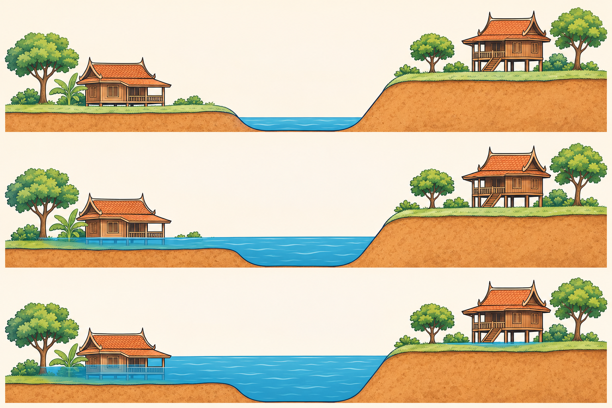
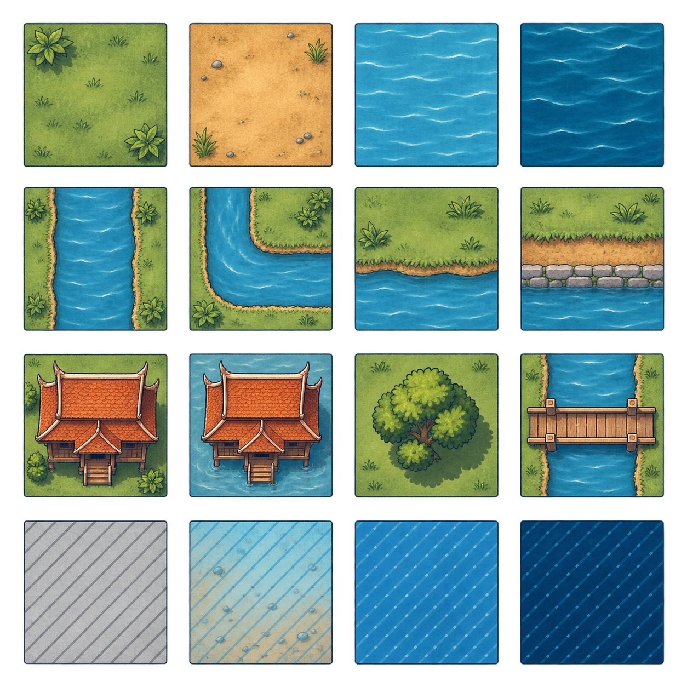

# GEOGLOWS three-day river-flow outlook developer plan

**Status:** Proposed developer handoff; no implementation authorised by this document  
**Prepared:** 9 November 2026  
**Visual design amended:** 12 November 2026 — river-village concept, theme and artwork below  
**Target codebase reviewed:** `SERVIRSEA/risk-servir-adpc`, default branch `master`, commit `496c3cc`  
**Product source:** `2026-10-07_MVP2_Story_Map_and_Data_Roles_LATEST.pptx`  
**Scope:** A reviewed, deterministic three-day **river-flow forecast** from GEOGLOWS. It is not yet a flood forecast, flood map, water-level forecast or warning.

## Decision in one paragraph

Build the first GEOGLOWS increment as a **three-day modelled river-discharge outlook for explicitly reviewed river reaches**. For each reach, show the pinned model run, valid times, median discharge, the P25–P75 ensemble band, the median peak and time, net trend, freshness and limitations. Store the exact upstream response and provenance so the result can be replayed. Do not use GEOGLOWS alone to say that flooding will occur, issue a watch, calculate water level, draw inundation, identify affected facilities or declare a shelter safe. Those outcomes require additional reviewed inputs, especially observed data, an agreed threshold or rating curve, terrain/HAND or a hydraulic model, and verification against past events.

## Why this is the correct first outcome

The MVP 2 story asks:

> Is a flood coming, from a river or heavy rain, where and when?

GEOGLOWS alone answers a narrower question:

> What discharge does the model forecast for this reviewed river reach over the next three days, and how do the ensemble members vary?

That narrower answer is useful and honest. It gives a planner a signal to review alongside ThaiWater observations and official agency information. It does **not** establish whether the river will overtop, where water will spread, or whether an authority should warn people.

The first UI must therefore use **“Three-day river-flow outlook”**, not “live flood forecast” or “flood warning.” “Live” should be reserved for observations such as ThaiWater station readings. GEOGLOWS is a model forecast refreshed daily.

## Concept primer

### 1. What GEOGLOWS forecasts

GEOGLOWS RFS v2 forecasts river discharge, conventionally written as **Q**, for a modelled river segment or reach.

- Unit: cubic metres per second (`m³/s`).
- Spatial object: one GEOGLOWS river reach ID, not an administrative district.
- Time: one model run has many future valid times.
- Uncertainty: 51 ensemble members in the current open forecast dataset. The REST `forecaststats` product summarizes those members and excludes the separate high-resolution member.
- Current published horizon: approximately 15 days; MVP 2 initially uses only 72 hours.

A value such as `12,500 m³/s` is a modelled volume of water passing a river cross-section per second. It is not a water elevation and not a flood depth.

### 2. The three times that must never be mixed

| Time | Meaning | Required field |
|---|---|---|
| Forecast run/issue time | When this forecast simulation starts | `issued_at_utc`, derived from the pinned run ID |
| Forecast valid time | When one forecast value applies | `valid_at_utc` on every point |
| Retrieval time | When GRP downloaded the bytes | `retrieved_at_utc` |

`metadata.gen_date` from the current REST response changes with retrieval and must **not** be treated as the forecast run time.

### 3. What the ensemble statistics mean

For each valid time, the first product should retain:

- `median_m3s`: the middle ensemble result;
- `p25_m3s` and `p75_m3s`: the middle 50% of ensemble members;
- optionally min, max and mean for specialist inspection, not the main headline.

P25–P75 is an ensemble spread, not a calibrated probability that the real river will lie inside the band. A narrow band, especially at the initial step, is not proof of certainty.

### 4. What a return period table means

The downloaded report compares forecast ensemble values with model-derived 2-, 5-, 10-, 25-, 50- and 100-year discharge thresholds. A displayed percentage is the proportion of model ensemble members exceeding a model threshold for that period. It is **not** the probability that a community will flood.

The live REST `returnperiods` request returned HTTP 500 during this review. The open AWS retrospective products contain return-period data, but MVP 2 should not expose threshold probabilities until:

1. the retrieval path and statistical method are pinned and tested;
2. a hydrologist reviews the reach and threshold interpretation;
3. the product wording distinguishes model-threshold exceedance from local flood probability; and
4. the product owner decides whether it supports a GRP watch rule.

### 5. How HAND fits later

HAND means **Height Above Nearest Drainage**. For each supported terrain cell, HAND approximates its height above the drainage cell to which it is connected.

A simplified scenario uses:

```text
GEOGLOWS discharge Q(t)
    -> reviewed discharge-to-stage relationship (rating curve)
    -> stage H(t) on the same reference as HAND
    -> depth_i(t) = max(H(t) - HAND_i, 0), inside a reviewed domain
```

GEOGLOWS supplies only `Q(t)`. It does not supply the locally reviewed rating curve, compatible vertical reference, HAND raster, barriers, gates, pumps, tide/backwater effects or validation. Therefore GEOGLOWS-only work must stop at the river-flow outlook.

The existing synthetic HAND implementation correctly demonstrates the arithmetic but does not create a real forecast depth map. See [`../../../core/hand_depth.py`](../../../core/hand_depth.py) and [ADR-0037](../../adr/0037-pilot-hand-practice-example-uses-made-up-ground.md).

## MVP 2 data-role interpretation

The story deck defines eight roles. Keep them separate in code, API and UI.

| Data | MVP 2 role | Permitted use in this increment |
|---|---|---|
| GEOGLOWS discharge | **Forecast** | Three-day modelled river-flow outlook |
| ThaiWater river level/flow/rain | **Fact (observed)** | Separate live panel; later comparison and verification |
| Rating curves | **Model input** | Not displayed as evidence by themselves |
| DEM, HAND and river geometry | **Model input** | Not a forecast result |
| Future HAND/hydraulic flood extent | **Forecast (modelled)** | Deferred until reviewed and validated |
| Agency warning | **Official warning** | Relay unchanged; GRP does not create it |
| JRC RP10–RP500 | **Scenario** | Static planning background, never current flooding |
| Shelters, schools, hospitals, roads, people | **Exposure** | Overlay only after a reviewed hazard extent exists |
| Past floods and officer checks | **Verification** | Replay and score forecast/model performance |

Only facts and **reviewed** forecasts may eventually contribute to a GRP watch rule. No rule is part of this GEOGLOWS-only increment.

## Evidence reviewed

### Local product material

| File | SHA-256 | Finding |
|---|---|---|
| `2026-10-07_MVP2_Story_Map_and_Data_Roles_LATEST.pptx` | `ab23fbcf0569f72d80335f690546dea04072b2c597f0c15687be0956395b5ef9` | MVP 2 asks for live observations plus a three-day forecast, with quick and detailed mapping as later stages |
| `forecast_430157411_2026-11-08.csv` | `bb2ad93ba4c68a2108b9b89bfc1c993420ed705ea79acbdd72390a986e4da449` | 120 three-hourly rows, 51 ensemble members, Min/P20/P25/Median/P75/P80/Max/Average, from 8–22 November 2026 |
| `GeoGlowReportFromGeoGlow.pdf` | `91014ceb89c16fb7f06f72dd5f580184c0fb12ed5ed31d74f47cb4d6937fbf7d` | A 17-page global example report with 16 named reaches, return-period thresholds and ensemble exceedance percentages |

The report is learning material, not Thailand evidence. Its pages are global examples (Mississippi, Nile, Colorado, Ganges, Mekong in Vietnam, and others). It does not identify a reviewed Thailand reach or prove local flood conditions.

### Live, read-only API checks on 9 November 2026

No credential was used and no data was submitted.

| Check | Result |
|---|---|
| `GET /api/v2/dates` | HTTP 200, `text/csv`; newest listed run `2026110900` |
| `GET /api/v2/forecaststats/430157411?format=json` | HTTP 200; parallel arrays and metadata |
| `GET /api/v2/forecastensembles/430157411?format=json` | HTTP 200; ensemble payload |
| Pinned `date=20261108` forecast statistics | 280 timestamp positions; 120 non-missing median/P25/P75 values; statistics present every three hours while other hourly positions are blank |
| `GET /api/v2/returnperiods/430157411?format=json` | HTTP 500; do not depend on this route |

The current official Python client documentation says:

- `forecast_stats` retrieves min, P25, mean, median, P75 and max for the 51 ensemble members;
- `forecast_ensembles` retrieves the ensemble series;
- AWS is the package's default source and supports multiple river IDs;
- REST supports one river ID per request;
- forecasts are daily, with three-hourly average discharge and about 15 days of lead time.

The AWS Open Data Registry states CC BY 4.0 and provides public forecast Zarr data. Confirm attribution wording with the product owner before release, but the earlier licence ambiguity is now narrower than it was in ADR-0036.

## Worked three-day example from the downloaded CSV

This calculation is a software example for reach `430157411`, labelled “Mekong, Vietnam” in the downloaded report. It is not a Thailand or Bang Bua Thong finding.

Window:

```text
[2026-11-08 00:00 UTC, 2026-11-11 00:00 UTC)
```

There are 24 three-hourly values.

| Statistic | Result |
|---|---:|
| First median | 14,411.64 m³/s |
| Last median in the window | 12,543.47 m³/s |
| Median peak | 14,411.64 m³/s |
| Peak valid time | 8 November 2026 00:00 UTC |
| Net direction | Falling |

The only defensible plain-language outcome is:

> For this modelled Mekong reach, the ensemble median discharge decreases over the first three days of the downloaded forecast. The highest median in that window is at its first valid time. This does not show whether any place floods.

It must **not** become “no flood is expected.” No local flood threshold, water level, inundation model or observation is present.

## Product contract: what GEOGLOWS-only can return

### Required response

```json
{
  "status": "available",
  "role": "forecast",
  "product": "geoglows_three_day_river_flow",
  "reach": {
    "reach_id": 430157411,
    "name": "reviewed display name",
    "review_status": "reviewed",
    "geometry_version": "...",
    "area_mappings": ["TH-..."]
  },
  "run": {
    "run_id": "2026110800",
    "issued_at_utc": "2026-11-08T00:00:00Z",
    "retrieved_at_utc": "2026-11-09T...Z",
    "source_url": "https://geoglows.ecmwf.int/api/v2/forecaststats/...",
    "raw_sha256": "..."
  },
  "window": {
    "decision_time_utc": "...",
    "start_utc": "...",
    "end_utc": "...",
    "hours": 72
  },
  "summary": {
    "units": "m3/s",
    "first_median_m3s": 0.0,
    "last_median_m3s": 0.0,
    "net_change_m3s": 0.0,
    "net_change_percent": 0.0,
    "trend": "rising | steady | falling",
    "median_peak_m3s": 0.0,
    "median_peak_valid_at_utc": "...",
    "p25_at_peak_m3s": 0.0,
    "p75_at_peak_m3s": 0.0,
    "complete_steps": 24
  },
  "series": [
    {
      "valid_at_utc": "...",
      "median_m3s": 0.0,
      "p25_m3s": 0.0,
      "p75_m3s": 0.0
    }
  ],
  "freshness": "latest | older",
  "limitations": [
    "Modelled river discharge, not an observation.",
    "Not water level, flood depth, flood extent or an official warning.",
    "No local flood threshold has been applied."
  ]
}
```

### Honest unavailable states

Use explicit states rather than empty arrays or zero values:

- `reach_not_reviewed`
- `no_reach_for_area`
- `upstream_unavailable`
- `run_list_invalid`
- `forecast_schema_changed`
- `wrong_reach`
- `units_invalid`
- `series_misaligned`
- `no_values_in_window`
- `run_older_than_policy`

A stale cached result may be returned with `freshness: older` and its original run time. It must never be relabelled as the latest run.

### Outcomes that are prohibited in this increment

Do not return or infer:

- `flood_expected: true/false`;
- a warning colour or warning level;
- water level in metres;
- inundation extent or depth;
- arrival time at a district or community;
- people/facilities affected;
- shelter safety or evacuation advice;
- a probability of local flooding;
- a statement that a district is normal or safe because data is missing.

## Three-day calculation rules

1. **Pin the run.** Read `/dates`, validate its actual CSV response, choose the newest usable run, and request it explicitly with `date=YYYYMMDD`. Preserve the ten-digit run ID.
2. **Use one decision window.** Save `decision_time_utc`. The product window is `[decision_time_utc, decision_time_utc + 72 hours)`, beginning at the first available valid step at or after the decision time. The same saved window drives API, chart, report and tests.
3. **Do not interpolate blanks.** The current REST response contains hourly timestamps but forecast statistics only every three hours. Keep complete statistic rows and report missing steps; do not invent hourly values.
4. **Validate arrays.** Require aligned arrays, increasing unique UTC timestamps, finite non-negative values, `P25 <= median <= P75`, matching reach ID and streamflow units in cubic metres per second.
5. **Keep high-resolution separate.** Do not fill missing ensemble statistics from `high_res` or mix it into the 51-member statistics.
6. **Peak rule.** Select the greatest median inside the window; choose the earliest valid time on a tie. P25/P75 shown with the peak come from that same valid time.
7. **Trend rule.** Base net trend on first versus last complete median, not on whether an intermediate peak exists. Use a reviewed tolerance such as ±5% for “steady”; expose the actual change so the label is auditable.
8. **Freshness rule.** Compare the pinned run with the available run list and an explicit publication grace period. Availability from `/dates` is authoritative; a fixed clock assumption is only a fallback. Retrieval and future valid times cannot make an old run fresh.
9. **No threshold in phase 1.** Do not call the broken REST return-period route or generate warning classes.
10. **UTC internally.** Display Asia/Bangkok time as an additional formatted value, never by replacing the UTC source fields.

## Reach and area governance

An administrative area is not a GEOGLOWS reach. A district may intersect zero, one or many modelled streams.

Create a reviewed mapping with:

- GEOGLOWS reach ID and versioned geometry;
- river/basin display name and language;
- intersecting/served GRP area codes;
- mapping rationale;
- `candidate`, `reviewed` or `retired` status;
- reviewer and decision reference;
- upstream-area and stream-order metadata where available;
- limitations, including areas where canals, gates, pumps, tides or backwater make the reach unrepresentative.

Do not automatically choose “the nearest river” for an operational answer. Nearest-point lookup is useful for discovery only. If an area has no reviewed mapping, return `no_reach_for_area`.

For the MVP 2 preparation story, start with reviewed reaches in the agreed Kok/Chiang Rai and Tapi/Surat Thani basins. Do not claim nationwide coverage from two reaches.

## Fit with the developer monorepo

The target monorepo currently has:

- FastAPI backend under `backend/app/`;
- PostgreSQL/PostGIS models and Alembic migrations;
- a storage service suitable for immutable raw-response files;
- a React/Next.js planning workspace;
- a LangGraph planning assistant in `backend/app/planning/`;
- data-library support for a `live_feed` kind, but no operational feed reader, forecast-run store or scheduler;
- no dedicated worker service yet.

The existing `DatasetVersion(kind="live_feed")` can later catalogue an approved source, but it is not sufficient for operational runs. A mutable URL is not a reproducible forecast. Store each fetched run and derived summary separately.

### Proposed backend modules

```text
backend/app/river_forecast/
    client.py          bounded GEOGLOWS HTTP client and dates/run retrieval
    parser.py          pure schema, time, unit and quantile validation
    summary.py         pure 72-hour window and deterministic statistics
    repository.py      reviewed reaches, raw runs and summaries
    service.py         orchestration, cache/stale policy and access rules
    schemas.py         request/response models
    router.py          protected read endpoints and internal/admin controls
    wording.py         fixed labels and limitations
```

Port the validated ideas, not the old API surface, from:

- [`../../../core/river_watch.py`](../../../core/river_watch.py);
- [`../../../api/river_watch.py`](../../../api/river_watch.py);
- [`../../../tests/fast/test_river_watch.py`](../../../tests/fast/test_river_watch.py);
- [ADR-0036](../../adr/0036-river-watch-pilot-reads-geoglows-as-display-only-evidence.md).

The existing prototype uses a seven-day in-process cache and exploratory allow-list. The new implementation should change the window to 72 hours, persist immutable run evidence and use reviewed reach mappings.

### Proposed persistence

Use dedicated tables rather than storing operational state only in a dataset `details` JSON object.

#### `river_forecast_reaches`

- `reach_id` (GEOGLOWS ID, primary identity)
- versioned geometry or a reference to a pinned geometry dataset
- display names and basin
- review status, reviewer reference and reviewed time
- mapping rationale and limitations
- active/retired state

#### `river_forecast_area_mappings`

- `reach_id`
- GRP `aoi_id`
- mapping role (`primary`, `supporting`)
- coverage/scope note
- unique `(reach_id, aoi_id)`

#### `river_forecast_runs`

- internal run ID
- source name and model version
- GEOGLOWS ten-digit run ID and issued time
- retrieval time, exact URL, HTTP metadata and raw SHA-256
- immutable raw file ID in the storage service
- parse status/error code
- unique `(reach_id, geoglows_run_id, raw_sha256)`

#### `river_forecast_summaries`

- run ID and deterministic summary version
- decision/window times
- summary JSON and normalized series JSON or child rows
- code release and created time
- reproducibility key
- unique run/window/summary-version key

Do not log raw payloads or full URLs with unexpected query values. The source URL is evidence in the protected record; logs should use reach, run, size, hash prefix, status and timing.

### Proposed API

All operations must declare `x-grp-access`.

```text
GET /v1/river-forecasts/reaches?hub_code=
GET /v1/river-forecasts/areas/{aoi_id}/latest?hub_code=
GET /v1/river-forecasts/reaches/{reach_id}/runs/{run_id}?hub_code=
GET /v1/river-forecasts/runs/{id}/raw?hub_code=        protected specialist download
POST /v1/internal/river-forecasts/pull                internal worker operation
```

The main area endpoint returns only reviewed mappings visible to the caller's Hub. Unknown and unauthorised areas must fail closed according to existing access conventions.

Do not add an anonymous/public feed in the first increment. Global Risk submission and MCP integration belong to GRP-47 after the local product passes review.

### Retrieval execution

#### Pilot scale

For a small, reviewed reach list, a bounded REST client is acceptable:

- 30-second total timeout;
- one retry for connection errors and 5xx only;
- maximum response size;
- no redirects to unknown hosts;
- allow-listed GEOGLOWS host;
- one fetch per reach/run;
- exact raw bytes stored before derivation;
- last good result returned as older when the newest retrieval fails.

#### Thailand scale

Do not loop over thousands or millions of reaches through REST. The official guidance says AWS is the efficient path and the Python client can retrieve multiple river IDs. For a reviewed national reach set:

- use the public forecast Zarr store from a scheduled ingestion worker;
- batch-select the reviewed reach IDs;
- pin the `geoglows` client and transitive data dependencies;
- benchmark memory, network and runtime before expanding;
- store only the required reach/run evidence and normalized 72-hour products.

The target monorepo has no dedicated worker today. Add one only after recording an architecture decision. A production forecast should be pulled on schedule and served from stored results; a web request should not wait for GEOGLOWS. A developer-only first slice may use a CLI/read-through path, but it must not be mistaken for the production schedule.

## Frontend plan

The current workspace has **Assess** and **Ask** tabs and a map. Add the smallest truthful UI before adding chat behavior.

### Three-day outlook card

For a selected area with a reviewed reach:

- title: `Three-day river-flow outlook (GEOGLOWS)`;
- river/reach name and review status;
- run time and “valid through” time in Bangkok time, with UTC in details;
- 72-hour chart with median and P25–P75 band;
- headline median peak and peak time;
- first-to-last net trend and actual change;
- freshness badge: `Latest available run` or `Older cached run`;
- fixed limitations box;
- source/provenance disclosure and raw evidence link for authorised specialists.

The map may show the reviewed river-reach line. It must not shade a district as flooded and must not render the reach line as an inundation extent.

If there is no reviewed reach, show:

> No reviewed GEOGLOWS river reach is mapped to this area. This is missing forecast coverage, not evidence that flooding is unlikely.

### Keep the panels separate

- ThaiWater: **Observed**.
- GEOGLOWS: **Forecast**.
- JRC RP maps: **Scenario**.
- Future HAND/hydraulic extent: **Modelled forecast map**.
- Official agency warning: **Official warning**, unchanged.

Use visible role badges and never merge the values into one unlabeled “flood risk” score.

## Community visual design amendment — 12 November 2026

### Lead with a river village people can recognise

Use a calm **riverside village** theme. Make the main teaching visual a side-view river cross-section with a house beside a low bank and another house on higher ground. Pair it with a small top-down village made from 2D tiles. Keep numeric raster inspection behind “ดูตัวเลขแต่ละช่อง”.

The side view answers “น้ำสูงถึงตรงไหนเมื่อเทียบกับพื้นดิน”. The top-down view answers “จุดนี้อยู่ตรงไหนในหมู่บ้านจำลอง”. A selected house or cell appears in both views using the same marker and selected-cell data.



*ภาพแนวทางศิลป์สำหรับหมู่บ้านสมมติ ลำดับภาพแสดงน้ำอยู่ในร่อง น้ำถึงฝั่งต่ำ และน้ำสูงขึ้นอีก ตัวอาคารและสเกลในภาพสร้างด้วย AI ใช้เป็นแนวภาพประกอบ ทีมพัฒนาต้องวาดรูปทรงและตำแหน่งน้ำจากค่าของแบบฝึกก่อนใช้เป็นภาพเชิงปริมาณ*

The generated image establishes the visual direction. It is illustrative and carries no calibrated metre scale. Build the interactive waterline, terrain and measurements as code-controlled layers. The actual scene must preserve its terrain, house positions, scale and camera when H changes. The generation prompts appear below for reuse.

### Two product experiences and their data

| Experience | What people see first | What drives the picture | Main interaction |
|---|---|---|---|
| GEOGLOWS outlook | A named river, a 72-hour flow chart, peak time and plain Thai trend | Stored GEOGLOWS discharge summary | Select a valid time and inspect the forecast values |
| Village practice | Low/high banks, homes, chosen waterline and a small tiled village | Existing synthetic HAND fixture and the user-selected H | Move the practice slider and select a house/cell |

Keep the practice control inside its own clearly labelled panel. A GEOGLOWS chart selection updates the flow chart's values. The practice slider updates only the synthetic village. Until a reviewed discharge-to-stage relationship and compatible terrain exist, there is no numeric connection between these controls.

Official documentation describes GEOGLOWS forecast statistics as river discharge for a river ID. The teaching waterline therefore comes from the practice H chosen by the user. [GEOGLOWS forecast data documentation](https://geoglows.readthedocs.io/en/latest/api-documentation/data.html#forecasted-streamflow)

The screenshot supplied on 12 November shows a seven-day prototype. The handoff target remains 72 hours. Update the window and its visible Thai wording together when the outlook is implemented.

### Suggested Thai wording

| Placement | Visible wording |
|---|---|
| Outlook heading | แนวโน้มปริมาณน้ำในแม่น้ำ 3 วันข้างหน้า |
| Forecast role badge | พยากรณ์จากแบบจำลอง |
| Trend sentence | แบบจำลองคาดว่าปริมาณน้ำไหลผ่านช่วงแม่น้ำนี้จะลดลงใน 3 วันข้างหน้า |
| Chart unit helper | ปริมาณน้ำที่ไหลผ่านแม่น้ำใน 1 วินาที |
| Forecast boundary | การทราบปริมาณน้ำยังต้องใช้ข้อมูลลำน้ำและระดับน้ำเพิ่มเติม เพื่อประเมินว่าน้ำจะถึงตลิ่งหรือบ้านหรือไม่ |
| Practice heading | ลองดู น้ำขึ้นถึงบ้านไหนก่อน |
| Persistent practice badge | แบบฝึก • พื้นดินและบ้านสมมติ |
| Practice slider label | เลือกความสูงของน้ำในแบบฝึก |
| Reference helper | เทียบกับระดับอ้างอิงร่องน้ำสมมติเดียวกัน |
| Low bank label | ฝั่งตลิ่งต่ำ |
| High bank label | ฝั่งตลิ่งสูง |
| Selected marker | บ้านตัวอย่าง A |
| Cell explanation | ช่องบนแผนที่แทนพื้นที่ย่อยหนึ่งส่วน แตะเพื่อดูความสูงของพื้นดินและน้ำ |
| Channel explanation | ร่องน้ำคือส่วนของลำน้ำที่น้ำไหลอยู่ ความสูงในแบบฝึกเทียบกับระดับอ้างอิงร่องน้ำสมมติ |
| Numeric detail toggle | ดูตัวเลขแต่ละช่อง |
| Missing terrain | ยังบอกไม่ได้ เพราะไม่มีข้อมูลความสูงพื้นดิน |
| Beyond domain | อยู่นอกขอบเขตแบบฝึก |

The trend sentence above is a wording template. Use “เพิ่มขึ้น”, “ใกล้เคียงเดิม” or “ลดลง” only from the deterministic summary. Show Bangkok valid times and the actual run freshness beside it.

### Practice interaction walkthrough

1. Open the village practice panel with the persistent fictional-data badge visible. Show the river, low/high banks, two house markers and the current selected H.
2. Let the person use a slider, keyboard arrow keys or a labelled numeric control to choose H between the existing 0–5 m bounds. Include a pauseable short demonstration only as an optional learning control.
3. Move a horizontal water surface against the fixed terrain. At H below the low bank, water remains in the drawn channel. When H passes the low bank in this deliberately connected teaching terrain, show water on that side. Keep higher terrain visible above water until its own threshold is reached.
4. Select a house or map cell. Highlight its matching marker in the cross-section and show one sentence explaining its ground/water relationship.
5. Offer “ทำไมจุดนี้มีน้ำ” to reveal the selected cell's arithmetic and reference. Keep the overview readable with numbers hidden.
6. Let the person reset the same fixture and compare chosen H values. The scene does not receive live flow values or local household coordinates.

Use ground-relative statements at each house marker. The existing HAND cell depth refers to the ground at that point. A decorative stilt house must not imply a known indoor depth or a surveyed floor elevation. If a floor line is shown, label it as fictional and store its own explicit fixture elevation.

Example sentence for an existing selected cell with ground height 2.6 m and chosen H = 3.0 m:

> จุดนี้มีพื้นดินสูง 2.6 เมตรจากระดับอ้างอิง เมื่อน้ำสูง 3.0 เมตร น้ำในแบบฝึกจึงสูงกว่าพื้นดิน 0.4 เมตร

At equal values, say:

> น้ำแตะระดับพื้นดิน ความลึกเหนือพื้นดิน 0 เมตร

For ground higher than the chosen water surface, say:

> พื้นดินจุดนี้ยังสูงกว่าน้ำในแบบฝึก

Render measurements as selectable HTML/SVG text. Never bake the selected H, ground height, depth, counts or state label into a generated picture.

### Theme and icon direction

| Token | Value | Use |
|---|---|---|
| Canvas | `#F7F3E8` | Warm paper background for the learning panel |
| Surface | `#FFFFFF` | Forecast and explanation cards |
| Main text | `#183746` | Headings, labels and outlines |
| River | `#237FA4` | Main water and selected river reach |
| Shallow overlay | `#B9DEEA` | Shallow practice water over visible ground |
| Medium overlay | `#62B1D0` | Medium practice depth |
| Deep overlay | `#245A7A` | Deeper practice water |
| Land | `#DCE6C7` | Terrain and vegetation |
| Exposed soil | `#C99B66` | Bank and ground cutaway |
| Roof | `#B86847` | Familiar Thai village houses |
| Selection | `#7344B5` | Selected house/cell outline and matching marker |
| Unknown | `#727C83` | Neutral hatch and question symbol |

Use rounded Thai sans typography, with `Noto Sans Thai` when available and `Tahoma, sans-serif` as fallbacks. Body text starts at 16 px, main learning sentences at 18–20 px, primary measurements at 28–36 px. Keep labels short and put units beside values.

Use one coherent 2D game illustration style with clear top-down tiles and a separate orthographic side view. Avoid rotating the quantitative cross-section into an isometric view, because perspective makes vertical comparisons harder. Texture and soft shadows can give the village depth while numbers and waterlines stay sharp.

Water colour shows relative teaching depth. Also show text and patterns. Green land is a terrain colour and carries no safety verdict. Keep red reserved for actual application errors or separately sourced official warnings.

### Tile art and rendering contract



*ชุดภาพต้นแบบสำหรับกำหนดสไตล์ของ tile ทีมพัฒนาต้องแยก ปรับกรอบ และตรวจรอยต่อก่อนใช้เป็น sprite atlas ในหน้าจอจริง*

Use the supplied PNG as an art reference. Inspect the actual sheet before assigning cells. The image-generation request uses four columns and four rows, but the file is not a validated production atlas.

The intended families are ground, river/channel/banks, village landmarks, and depth/unknown states. Production assets should be normalized to 128 × 128 px source slots, rendered near 48–64 CSS px on desktop. Allow inner transparent padding so roofs and shadows fit. Use explicit tile IDs in the developer manifest. A side-view house requires a separate side-view asset.

| Layer order | Content | Data responsibility |
|---|---|---|
| 1 | Valid-domain mask | Existing synthetic fixture |
| 2 | Terrain and channel | Existing fixture cell heights and channel layout |
| 3 | Water/depth fill | Existing server-calculated cell result |
| 4 | House/tree/bridge artwork | Deterministic fictional placement in the fixture |
| 5 | Unknown and outside-domain patterns | Existing validity state, always visible |
| 6 | Selection, marker and optional numbers | Current user selection |

Keep the current 12 × 20 fixture and its server-calculated depth/counts. Every source cell keeps its own identity. Decorative sprites may span cells, but cannot replace missing terrain, change counts, or introduce elevations. A house label identifies one anchor cell for its ground-level explanation.

For 240 cells, DOM/SVG rendering is sufficient. Keep one reusable art sheet or a small SVG symbol set, and update only the water, selected marker and text when H changes. A canvas can be considered later if profiling justifies it. Use the existing protected demo route and preserve its validation and authorization.

The practice formula and edge states remain those in [ADR-0037](../../adr/0037-pilot-hand-practice-example-uses-made-up-ground.md). An equal water/ground value has depth zero and is not counted wet. Unknown and outside-domain cells remain visually distinguishable. On a new slider request, update summary counts, map and cross-section from the same successful response. Discard stale responses. If the request fails, keep the last confirmed scene labelled with its confirmed H and show the error beside the pending control.

The simple HAND rule is a terrain screening demonstration. Do not add a connectivity, bridge, levee or indoor-flood calculation just because such an object is drawn. Draw the teaching cross-section with simple connected terrain. If later evidence introduces barriers, pumps, tides or disconnected depressions, require an explicit reviewed method before interpreting those effects.

### Responsive layout and comprehension checks

On desktop, put the large cross-section above the slider. Place the tile village and selected-house explanation beside each other below it. Keep the forecast card and chart above this separately framed practice panel.

On a phone, show the same order as one column. Keep the cross-section readable without horizontal panning. Let the tiled map pan or zoom inside its own container while retaining a visible selection and a text/table equivalent. Keep controls at least 44 CSS px high. Prefer a selected-marker outline to tiny always-visible raster numbers.

Validate these behaviours before acceptance:

- A person can point out the low bank, high bank, river channel and selected house using the illustration.
- The same person can explain why the low side is reached first in the fictional demonstration.
- Moving H preserves terrain geometry, house positions, camera and vertical scale.
- Selecting a marker uses the same source cell in the map, cross-section and arithmetic.
- Water depth is above local ground and uses the same reference as H and the fixture.
- At H = ground, the label says water's edge and the wet count does not increase.
- Unknown cells remain hatched even when nearby cells are coloured blue.
- Every interactive state exposes its fictional-data badge, including screenshots and exported teaching views.
- Changing the GEOGLOWS valid time changes forecast discharge values only.
- A stale/unavailable forecast has explicit wording alongside the chart.
- Keyboard, touch, reduced-motion mode and a non-colour text alternative work.
- Test with three to five lay readers. Ask them what the picture tells them, which part is fictional, and whether it predicts water at their actual home. Revise the copy if they confuse those roles.

### Asset generation prompts

Both PNGs were requested with the built-in image-generation tool. They are concept artwork. Keep this prompt set with the handoff so the art direction can be reproduced.

<details>
<summary>River cross-section concept prompt</summary>

```text
Use case: scientific-educational. Create a polished landscape concept illustration for a Thai river-community learning interface. Wide canvas approximately 3:2. Three equally sized horizontal panels stacked vertically with generous clear separation. In every panel use EXACTLY the same side-view cutaway terrain, same houses and trees, same scale and camera. A river channel sits in center. On left a low bank and a low one-storey Thai riverside house on ground elevation 1.5 units above a clear shared channel reference. On right a much higher bank and a second Thai house at 4 units above reference. Cross-section shows warm ochre soil below pale sage grass, central U-shaped blue river channel, small round trees. Top panel water is low, contained in central channel below both banks. Middle panel water is higher, overtops connected low left bank and reaches lower part of left house, while high right bank and house remain visibly above water. Bottom panel water is higher again and reaches both banks, with low left house more submerged and only the base of high right house touched. Water surface must be perfectly horizontal across connected areas in each panel. Muted teal, navy outlines, warm cream background, terracotta roofs, luminous but restrained blue water. Charming crisp 2D educational game illustration, architectural side cutaway, adult-friendly civic product, clean elegant shapes and gentle texture, no photorealism and no 3D perspective. Do not include any lettering, words, numbers, UI, gauges, logos, rain clouds, danger colors, evacuation arrows, legends, or map coordinates. Leave a narrow empty margin at top of each panel for later HTML labels. This is fictional teaching artwork, not a real forecast or local geography. Visually clear at small size.
```

</details>

<details>
<summary>Transparent village tile sheet prompt</summary>

```text
Use case: stylized-concept. Create one transparent PNG art sheet of isolated, consistent 2D orthographic TOP-DOWN game tiles for a Thai riverside village learning map. Layout exactly 4 columns by 4 rows, sixteen equal square slots, ample internal padding and no overlap, no labels or grid lines. Every tile must have same light direction, same scale, crisp softly outlined adult-friendly educational game style, navy edge details, sage land, ochre sandy earth, terracotta roofs, river blues, subtly textured finish. Row 1 slots left to right: square grassy ground tile, square sandy bare ground tile, square blue calm water tile, square deeper blue water tile. Row 2: straight vertical river segment with grassy banks both sides, right-angle river bend, low grassy riverbank edge, high embankment edge with visible ochre strip and tiny top-down retaining stones. Row 3: single Thai red-roof one-storey house top-down, matching same house with light blue floodwater around its base, small tree, simple footbridge oriented horizontally. Row 4: four square informational state tiles with attractive neutral diagonal hatching or dot motifs, respectively unknown terrain grey, shallow water pale blue with visible ground, medium water blue, deep water navy. No human figures, no text, numbers, arrows, traffic lights, icons that imply safety, or real-world place identifiers. Background fully transparent and art tiles isolated. This is a concept asset sheet for developers to redraw and normalize, do not imply seamless edges. Keep shadows inside each slot.
```

</details>

## AI integration plan

Add AI only after the deterministic API and UI pass acceptance.

1. Add an `explain_forecast` mode to the planning graph.
2. Resolve the selected area and reviewed reach in code; the model must not choose a river ID.
3. Load the stored summary in code.
4. Give the model only the bounded summary, question and fixed limitations.
5. Gate the response against allowed numbers/times and prohibited claims.
6. Append a fixed footer with source, run, valid window, forecast role and limitations.
7. If AI fails, return a deterministic summary; the chart and data remain available.

Example supported questions:

- “What is the three-day river-flow outlook here?”
- “When does the median flow peak?”
- “Is the model rising or falling over the next three days?”
- “How wide is the ensemble spread at the peak?”

Required declines:

- “Will my house flood?”
- “Which shelter is safe?”
- “Issue a warning.”
- “What will the water depth be?”

The answer should explain what additional data is missing rather than merely say “cannot.”

## Implementation sequence

### Stage 0 — decisions and fixtures

**Owners:** Product owner, hydrology reviewer, data team

- Confirm the first user and decision supported.
- Confirm Kok/Chiang Rai and Tapi/Surat Thani as the initial basins or change them.
- Nominate reviewed reach IDs and geometries.
- Approve the wording “three-day river-flow outlook.”
- Confirm CC BY 4.0 attribution and reuse terms.
- Record whether the product is informational only or may later feed a GRP watch rule.
- Preserve one pinned forecaststats response and one 51-member ensemble response per test reach.

**Exit evidence:** reviewed reach table, source decision, fixture hashes and approved limitations.

### Stage 1 — deterministic captured-data slice

**Owners:** Backend developer

- Port/adapt the pure parser and summary rules.
- Implement the 72-hour window.
- Parse both the current REST parallel-array JSON and the saved CSV fixture through explicit adapters into one internal schema.
- Produce the product contract without network access.
- Add malformed/missing/stale fixtures.

**Exit evidence:** offline tests reproduce the downloaded CSV example and reject bad inputs.

### Stage 2 — bounded live retrieval and persistence

**Owners:** Backend developer, operations

- Add `/dates` parsing and pinned forecaststats retrieval.
- Store raw bytes in the storage service with SHA-256.
- Store run and summary records transactionally.
- Add idempotency/reproducibility keys.
- Implement older-cache fallback and unavailable states.
- Add metrics for fetch status, duration, bytes, run age and parse failures.

**Exit evidence:** two consecutive runs are stored and replayable; upstream failure serves the older run with an explicit label.

### Stage 3 — workspace card and reach map

**Owners:** Frontend developer, product owner

- Add the role-labelled 72-hour chart/card.
- Apply the riverside-village theme from the visual design amendment. Build the side-view practice scene and matching tile selection from the existing synthetic fixture, with the fictional-data badge visible.
- Add reviewed reach geometry.
- Add no-coverage, stale and unavailable states.
- Ensure selected-area changes cancel or replace the prior forecast request.
- Provide keyboard, small-screen and bilingual acceptance.

**Exit evidence:** a planner can identify reach, run, peak, trend, valid window, source and limitations without interpreting the card as a warning.

### Stage 4 — observations and replay, still no automatic warning

**Owners:** Data team, hydrology reviewer, developer

- Display ThaiWater observations separately.
- Map stations to reviewed reaches with an explicit decision.
- Replay named past events.
- Score forecast discharge against compatible observed discharge, not against gauge level in metres.
- Record missing/quality/datum differences.

**Exit evidence:** a review report states forecast performance and limitations for each pilot reach.

### Stage 5 — AI explanation

**Owners:** AI developer, product owner

- Add deterministic routing and grounded explanation.
- Add numerical and prohibited-claim gates.
- Add golden questions in English and Thai.
- Keep a deterministic fallback.

**Exit evidence:** every reported value matches the stored summary and no answer promotes forecast Q into observed flood, water level, depth or warning.

### Stage 6 — later threshold, quick map and detailed model work

Separate decisions are required for:

- model return-period or agency threshold display;
- a reviewed local rating curve and datum;
- DEM/HAND/domain suitability;
- quick-method extent/depth;
- BYU hydraulic-model outputs;
- exposure overlays;
- a GRP watch rule;
- Global Risk/MCP publication.

None is implied by completing Stages 0–5.

## Test plan

### Parser and contract tests

- actual `/dates` CSV, including wrong header, empty and malformed run IDs;
- arrays absent, wrong type or different lengths;
- wrong reach ID;
- wrong/missing units;
- naive, non-UTC, duplicate or non-increasing times;
- blank values remain missing, never zero;
- negative, NaN and infinite flow rejected;
- quantile order violation rejected;
- high-resolution member never fills ensemble-stat gaps;
- response-size cap and non-JSON error body.

### Three-day summary tests

- window includes start and excludes end;
- mixed hourly timestamps/three-hour statistics;
- exactly 24 three-hour complete points when available;
- tied peak chooses earliest;
- P25/P75 taken at the median peak time;
- rising, falling and steady use first-to-last change;
- an intermediate peak does not incorrectly force a “rising” final trend;
- no complete values returns unavailable, not zero;
- UTC/Bangkok formatting preserves the source instant;
- same raw input, decision time, config and code version reproduce the same result.

### Repository/service tests

- duplicate pull is idempotent;
- raw file hash matches stored bytes;
- incomplete/failed run never becomes latest successful;
- newest upstream failure serves prior run as older;
- no prior run plus upstream failure returns unavailable;
- Hub and role access cannot cross boundaries;
- raw evidence download is protected;
- audit stores IDs/status/support reference, not payload or chat text.

### Frontend tests

- selected area loads only its reviewed reach;
- changing area cannot leave the old chart under the new area;
- no mapping is a visible data gap;
- stale/unavailable labels are prominent;
- chart uses real time, a zero baseline where appropriate and an accessible table alternative;
- observed, forecast, scenario and official-warning roles remain visually distinct;
- no flood polygon is inferred from a reach line.

### AI/golden tests

- exact peak, trend, band and time questions;
- “Will it flood?” explains the missing threshold/stage/map evidence;
- “Which shelter is safe?” is refused without a safety claim;
- Thai and English questions resolve to the same stored result;
- prompt injection cannot alter reach, run, numbers or role;
- provider failure returns the deterministic summary.

## Acceptance criteria

1. Every forecast value is traceable to a reviewed reach, pinned GEOGLOWS run, valid time, retrieval, URL and raw hash.
2. The displayed window is exactly 72 hours by the declared rule.
3. Independent calculation reproduces median, P25, P75, peak, peak time and trend from the stored raw response.
4. Missing and stale data are explicit and never converted to zero or “normal.”
5. The UI calls the result a modelled river-flow forecast and shows the data-role badge.
6. No screen, API or AI answer claims flood occurrence, water level, depth, extent, impact, shelter safety or official warning from GEOGLOWS alone.
7. Only reviewed reach-area mappings appear to normal planners.
8. Upstream failure does not erase the last good run and cannot make it appear fresh.
9. Raw evidence is immutable and replayable.
10. Fast and contract tests pass; the exact target-host retrieval path is tested before staging acceptance.
11. A hydrology reviewer signs the reach mapping and product limitations.
12. No public feed, Global Risk contribution or automatic watch is enabled by this work.

## Decisions still required

1. Who is the first operational user and what decision should the card support?
2. Which exact Kok and Tapi reach IDs are reviewed for the first release?
3. Which areas may legitimately display each reach's forecast?
4. What publication delay/freshness policy should be operationally approved?
5. Is the first product informational only, or is a later GRP watch intended?
6. Which ThaiWater observation is compatible with each reach for verification?
7. Who owns any future threshold and action rule?
8. Which past events will be replayed and what performance measures pass?
9. Is the future “quick method” genuinely suitable, given rating curves, datum, terrain, controls and backwater?
10. What outputs and rights will BYU provide for the detailed hydraulic phase?

## Explicit non-goals

- heavy-rain or flash-flood prediction;
- official warning generation;
- automatic evacuation recommendation;
- real-time flood extent/depth from GEOGLOWS alone;
- converting JRC return-period maps into current forecasts;
- guessed rating curves or stage offsets;
- nationwide REST loops over all GEOGLOWS reaches;
- public or MCP publication before review;
- using an LLM to calculate or select hydrological values.

## References

- [MVP 2 story and data roles](2026-10-07_MVP2_Story_Map_and_Data_Roles_LATEST.pptx)
- [Downloaded GEOGLOWS ensemble CSV](forecast_430157411_2026-11-08.csv)
- [Downloaded GEOGLOWS report](GeoGlowReportFromGeoGlow.pdf)
- [Existing River Watch ADR](../../adr/0036-river-watch-pilot-reads-geoglows-as-display-only-evidence.md)
- [Existing HAND practice ADR](../../adr/0037-pilot-hand-practice-example-uses-made-up-ground.md)
- [Existing River Watch/HAND plan](../../pilot/2026-10-02_Bang_Bua_Thong_GEOGLOWS_River_Watch_Plan.md)
- [GEOGLOWS Python API documentation](https://geoglows.readthedocs.io/en/latest/api-documentation/data.html#forecasted-streamflow)
- [GEOGLOWS training: accessing data](https://training.geoglows.org/rfs/accessing-data/code-snippets/)
- [GEOGLOWS v2 AWS Open Data Registry](https://registry.opendata.aws/geoglows-v2/)
- [GEOGLOWS REST service](https://geoglows.ecmwf.int/api/v2/dates)
