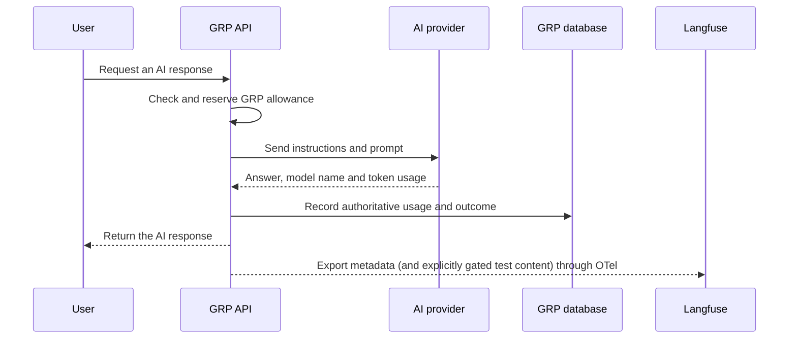

# How Langfuse works with GRP

## Purpose

GRP uses Langfuse to monitor AI calls, token usage, model selection, latency and outcomes. Langfuse
is an observability service; it does not enforce a person's GRP token allowance and it is not the
official usage record.

## Data flow



Every provider call goes through the GRP AI gateway. The provider response supplies the actual
model identifier and token counts. GRP records them in its database before scheduling a
best-effort Langfuse export.

## What Langfuse receives

Each Planning question creates one `grp-planning-question` trace. Its child observations show the
AI router, Global Risk MCP tools such as `assemble_pack`, and the AI draft.
Calls made during one signed-in GRP login also share a pseudonymous Langfuse session, so the
Sessions view can group multiple question traces without receiving the real GRP session value.
Other single-call workflows continue to use a `grp-ai-call` trace. GRP exports:

- the model identifier returned by the provider;
- input, output and total token counts;
- start time, end time and duration;
- completed or failed outcome;
- prompt-version identifier;
- GRP channel and Hub code;
- deployment environment;
- a one-way pseudonymous person reference; and
- a separate one-way session reference that groups AI calls made during one GRP login.

By default, GRP does **not** export prompts, instructions or AI answers. A stakeholder demonstration
may show real Planning and AI input/output only when the local deployment has both content capture
switched on and the signed-in email in its allow-list. Production refuses this mode.

GRP never exports:

- names or email addresses;
- passwords, API keys, cookies or the real GRP login-session identifier;
- raw MCP arguments or results; or
- raw assessment source records.

## Tokens and cost

Token counts are not estimated by Langfuse. The AI provider reports the counts and GRP forwards
them. For example, a provider may report 49 input tokens and 17 output tokens, giving 66 total
tokens.

Langfuse can estimate cost when its model catalogue recognizes the exact model identifier and has
current pricing. If a dated or organization-specific model is unknown, an administrator must add
custom pricing or GRP must export explicit costs. A missing Langfuse cost must not be interpreted
as a free AI call.

The current integration exports standard input and output totals. A question trace sums cost from
its generation children; MCP tool spans have no model cost. Separate cached-input and
reasoning-token categories remain future work.

## Source of truth and failure behavior

The GRP database is authoritative for monthly allowances and recorded usage. Langfuse is a
monitoring and evaluation copy. Export runs after the operational usage record is committed, and
a Langfuse outage must not block or change the GRP response.

Historical calls rejected by the former legacy integration are not recreated automatically.
Only calls made after the Langfuse v4 OTel integration produce new observations.

## Projects and environments

The self-hosted service is at:

- <https://langfuse-risk-servir.adpc.net>

GRP has separate Staging, Evaluation and Production projects. Project API keys determine which
project receives an observation. Development testing currently uses **GRP Evaluation** with the
`development` environment. Production telemetry remains disabled until its operational gates are
approved.

## Enable stakeholder trace content locally

Use this only with reviewed demonstration questions. Content persists in the Evaluation project
according to its retention policy, so do not enter personal information, credentials or restricted
operational material.

In the ignored repository `.env`, set:

```dotenv
LANGFUSE_CAPTURE_CONTENT=true
LANGFUSE_EVAL_TEXT_ACCOUNTS=your.approved.account@example.org
```

Multiple approved accounts are comma-separated. Both settings are required, matching is
case-insensitive, and `GRP_ENV=production` always refuses content capture. Rebuild from PowerShell
with `.\scripts\docker-desktop.ps1` after changing the settings. Set
`LANGFUSE_CAPTURE_CONTENT=false` and rebuild when the demonstration is finished.

This mode populates input/output on the Planning root and AI generation children. MCP tool children
remain metadata-only to prevent arguments, upstream responses and credentials from entering
Langfuse.

## Plain-language dashboard

The **GRP AI at a glance** dashboard provides a simpler team view:

- [Open GRP AI at a glance](https://langfuse-risk-servir.adpc.net/project/cmv90jcpl0008mu28iv24dmf2/dashboards/cmv99wqu5000ynv27qbd7miqv)
- **AI requests:** number of recorded AI operations.
- **Estimated cost:** provider-cost estimate; blank means pricing is unavailable, not free usage.
- **Average response time:** typical duration across the selected period.
- **Requests by model:** models that handled requests.
- **Estimated cost by model:** cost distribution where model pricing is recognized.
- **Requests by workflow:** which GRP functions used AI.
- **Slow-call indicator:** the 95th-percentile duration; lower is better.

The widgets are filtered to the `development` environment. Use a recent dashboard time range when
checking a new call. The dashboard is reproducibly managed by
`scripts/langfuse_layman_dashboard.py`; the script does not print credentials.

## How to verify a trace

1. Sign in to GRP with access to Planning.
2. Open **Planning**, select a supported area and leave at least one **Global Risk layer**
   selected.
3. Ask a short planning question and wait for the answer. This exercises the router, the
   `assemble_pack` MCP tool and, when needed, the drafting model.
4. Open **GRP Evaluation → Tracing** in Langfuse.
5. Select environment **development** or **All** and a recent time range.
6. Refresh and open the latest `grp-planning-question` trace.
7. Confirm the question trace contains router and draft generation children and, when Global Risk
   was requested, an `mcp.assemble_pack` tool child.
8. Confirm model, token usage, metadata `duration_ms` and outcome are present. With stakeholder
   content enabled for your account, confirm the Planning root and AI generations show their real
   input/output. Standard Langfuse latency remains near zero until GRP opens spans at operation
   start rather than exporting completed records afterward.
9. Confirm MCP children still have no input/output and no email address, credential, cookie or real
   session identifier appears anywhere.

If the AI response succeeds but no trace appears, check the GRP API logs for `Langfuse export
failed`, verify that the API key belongs to the selected project, and confirm that no environment
or time filter is hiding the observation.

## Claude MCP access

Approved users can follow
[Connect Claude to the GRP Langfuse MCP server](connect-claude-to-grp-langfuse-mcp.md).
The project key provides both read and write MCP tools, so centrally managed configuration and a
read-only tool allowlist are preferred over distributing credentials to normal users.

## Technical implementation

GRP uses the Langfuse 4.x Python SDK and its OpenTelemetry ingestion path. The dedicated Langfuse
4.59.0 server runs in `events_only` mode, so legacy `trace-create` and `generation-create` batches
are not supported. The integration decision and migration rationale are recorded in
[ADR-0069](../adr/0069-langfuse-v4-uses-otel-ingestion.md).
